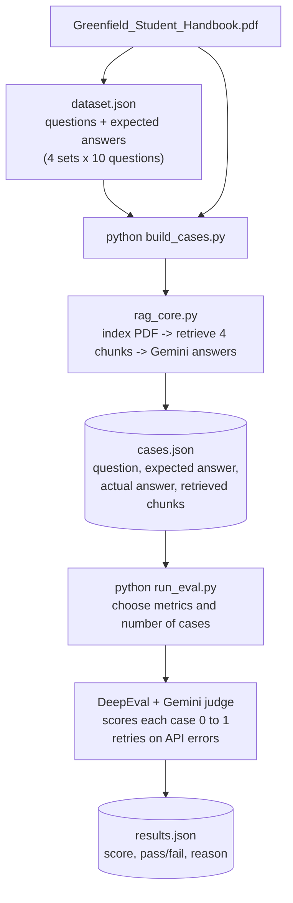

# grade-pdf

Evaluate a PDF question-answering chatbot (RAG) with [DeepEval](https://github.com/confident-ai/deepeval).

The project answers questions about a PDF (here, a sample student handbook), then uses an LLM judge to
**grade** the quality of those answers and of the retrieval behind them.

## What it does

1. **Indexes the PDF.** Splits it into chunks, embeds them with Gemini embeddings and stores them in Chroma.
2. **Answers questions.** For each question, retrieves the 4 most relevant chunks and asks Gemini to answer
   using only those chunks.
3. **Grades the results** with four DeepEval metrics, scored from 0 to 1 by a Gemini judge:

| Metric | What it checks | Stage |
|---|---|---|
| `answer_relevancy` | Does the answer actually address the question? | Query |
| `faithfulness` | Is the answer supported by the retrieved context (no made-up facts)? | Query |
| `contextual_precision` | Are the most useful chunks ranked first? | Retrieval |
| `contextual_recall` | Did retrieval find all the info needed for the expected answer? | Retrieval |

## How it works



| File | Role |
|---|---|
| `dataset.json` | Your test questions and the expected answers (the input to the pipeline). |
| `rag_core.py` | The RAG pipeline: load PDF, chunk, embed, retrieve, answer. |
| `build_cases.py` | Runs every question through the RAG pipeline and saves `cases.json`. |
| `run_eval.py` | Grades `cases.json` with the chosen metrics and saves `results.json`. |

## Setup

### 1. Install uv

[uv](https://docs.astral.sh/uv/) manages Python and the dependencies for you.

```sh
# macOS / Linux
curl -LsSf https://astral.sh/uv/install.sh | sh

# Windows (PowerShell)
powershell -c "irm https://astral.sh/uv/install.ps1 | iex"
```

Check it worked with `uv --version`. You don't need to install Python yourself: uv downloads the
version the project needs (3.12 or newer).

### 2. Clone the repo and install dependencies

```sh
git clone https://github.com/<your-username>/grade-pdf.git
cd grade-pdf
uv sync
```

`uv sync` creates a `.venv` folder and installs everything listed in `pyproject.toml`. You never need to
activate the environment, because `uv run` uses it automatically.

### 3. Add your Gemini API key

Get a free key from [Google AI Studio](https://aistudio.google.com/apikey), then:

```sh
cp .env.example .env
```

Open `.env` and replace the placeholder:

```
GEMINI_API_KEY=your_real_key_here
```

`.env` holds your secret key, so never commit it. It is already listed in `.gitignore`.

## Run it

Run these from the project folder. Note the `.py` at the end of each script name.

### Step 1: Write your test questions

Edit `dataset.json`. It has four sets, one per metric, and each row looks like this:

```json
{
  "question": "What is the tuition fee per year?",
  "expected_output": "The tuition fee is Rs 1,20,000 per year, paid in two instalments of Rs 60,000 each."
}
```

The sample handbook and questions are already included, so you can skip this step on a first run.
Empty questions are rejected.

### Step 2: Build the test cases

```sh
uv run build_cases.py
```

This indexes the PDF and answers every question in `dataset.json` (40 with the sample data, with a
1-second pause between questions to respect rate limits). It saves `cases.json`. Run it again only
when you change the PDF or the questions.

### Step 3: Grade them

```sh
uv run run_eval.py
```

This scores every metric and saves `results.json`. While it runs, it prints each case and its score:

```
===== answer_relevancy (2 cases) =====
[answer_relevancy 1/2] What is the tuition fee per year?
   score: 1.0  passed: True
```

To run just one metric, or a different number of cases:

```sh
uv run run_eval.py faithfulness       # one metric
uv run run_eval.py faithfulness 5     # one metric, 5 cases
```

### Step 4: Read the results

Open `results.json`. Each entry has the metric, the question, the model's answer, the `score`, whether it
`passed` (score of 0.7 or more) and the judge's `reason`.

## Settings

The settings are at the top of [run_eval.py](run_eval.py):

| Setting | Default | Meaning |
|---|---|---|
| `METRICS_TO_RUN` | all four | Which metrics to run. Delete the ones you don't want. |
| `CASES_PER_METRIC` | `2` | How many cases to score per metric. Use `None` for all. |
| `RETRIES` | `3` | How many times to retry if the API fails. |
| `WAIT_SECONDS` | `30` | Seconds to wait between retries. |
| `RESULTS_FILE` | `results.json` | Where the results are saved. |

## Use your own PDF

1. Put your PDF in the project folder.
2. Change `PDF_PATH` in `build_cases.py` to its file name.
3. Replace the questions and expected answers in `dataset.json`.
4. Run steps 2 and 3 above.

## Troubleshooting

| Problem | Fix |
|---|---|
| `Failed to spawn: run_eval` | Add `.py`: `uv run run_eval.py`. |
| `Google Gemini API key is not configured` | Check that `.env` exists and contains `GEMINI_API_KEY=...`. |
| `503 UNAVAILABLE` / high demand | Temporary overload on Google's side. `run_eval.py` retries automatically. Raise `RETRIES` or `WAIT_SECONDS` if it persists. |
| `429` / quota errors | You hit the free-tier rate limit. Wait a minute, or lower `CASES_PER_METRIC`. |
| `cases.json` not found | Run `uv run build_cases.py` first. |

## Tech stack

Python 3.12, [uv](https://docs.astral.sh/uv/), [LangChain](https://www.langchain.com/),
[Chroma](https://www.trychroma.com/), [DeepEval](https://github.com/confident-ai/deepeval),
Google Gemini (answers, embeddings and judge).
